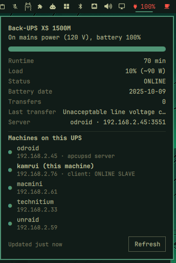

# UPS Status

An [Omarchy](https://omarchy.org/) bar widget for a UPS monitored by
[apcupsd](http://www.apcupsd.org/): battery charge on the bar, the details in a panel, and the
machines the UPS powers, with a notification when mains power is lost or restored.

<p></p>

| Bar shows | Meaning |
|---|---|
| `󰚥 100%` | On mains power, battery charge |
| `󰂄 90%` | On mains, battery recharging (below 95%) |
| `󰂃 80% 45m` (highlighted) | **On battery**: charge and minutes left |
| `󰚦 UPS?` (highlighted) | apcupsd isn't answering |

- **Hover**: a one-line summary and how many of your machines answer.
- **Click**: the panel. It shows model, mains voltage, a charge bar, runtime, load (% and watts), status,
  battery date, number of transfers and the reason for the last one, the apcupsd server, and the machines
  on the UPS. A filled dot means the machine answers a ping and a hollow one means it doesn't. The line for
  this machine also shows its own apcupsd client status. **R** or **Refresh** checks now, Esc closes it.
  **Right-click** checks now and opens the panel.
- **Notifications**: one when the UPS goes on battery or stops answering (critical) and one when power
  is back (normal), only on a change. "Not answering" takes 3 failed checks in a row, so a single dropped
  check (a busy apcupsd, a network blip) doesn't raise a false alarm.

It works with any UPS apcupsd supports (APC, and CyberPower and others through the USB HID driver), whether
the UPS is plugged into this machine or into another one on your network.

## Install

```bash
omarchy plugin add https://github.com/jchisholm59/omarchy-ups-status.git --enable
```

Needs `apcaccess`, which comes with the `apcupsd` package (install it with your package manager),
and `python3`, `ping` and `notify-send`, all part of a stock Omarchy install. The plugin itself runs
without elevated privileges.

With no settings it reads your own apcupsd at `127.0.0.1:3551`. That works when the UPS is plugged into
this machine, and when this machine is an apcupsd network client (`UPSCABLE ether`, `UPSTYPE net`,
`DEVICE <server>:3551`) of the machine that has the UPS. Either way, apcupsd's Network Information Server
has to be on (`NETSERVER on`, the default).

## Settings

Add any of these to the widget's entry in `~/.config/omarchy/shell.json`. The bar reloads on save.

```json
{
  "id": "jim.ups-status",
  "server": "192.168.1.45:3551",
  "machines": [
    { "name": "nas", "host": "192.168.1.20" },
    { "name": "dns", "host": "192.168.1.33" },
    "router=192.168.1.1"
  ],
  "interval": 15,
  "notify": true
}
```

| Setting | Default | |
|---|---|---|
| `server` | `127.0.0.1:3551` | Any apcupsd Network Information Server (`host:port`; the port defaults to 3551). Point it at the machine the UPS is plugged into to read it directly. That machine's apcupsd must listen on the network (`NISIP 0.0.0.0`). |
| `machines` | none | The machines on the UPS, as `{ "name", "host" }`, `"name=host"` or just `"host"`. Each gets one ping per check. Leave it out to hide the list. |
| `interval` | `15` | Seconds between checks (minimum 5). |
| `notify` | `true` | Set to `false` to turn the notifications off. |

`allowMultiple` is on, so you can add a second entry with a different `id` suffix and `server` to watch
another UPS.

## How it works

Every `interval` seconds, `bin/ups-status` runs `apcaccess status <server>` and pings each machine once
(1 s timeout, all in parallel), then prints one JSON object for the panel. It reads only what apcupsd
reports, and it never sends commands to the UPS or changes apcupsd's configuration. Nothing leaves your network.

## Remove

```bash
omarchy plugin remove jim.ups-status
```

That turns the widget off and deletes the plugin folder. It keeps no files of its own anywhere else, and
apcupsd itself is left as it was.

## License

[MIT](LICENSE)
